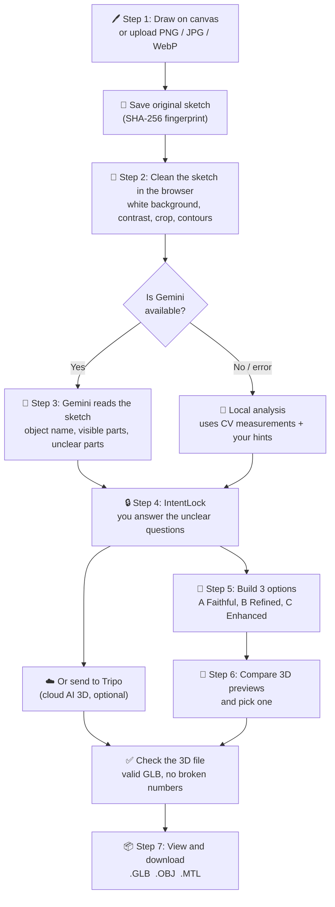
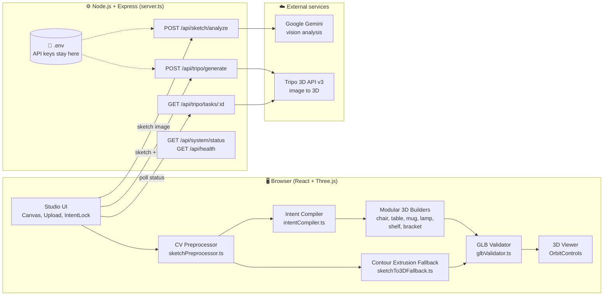
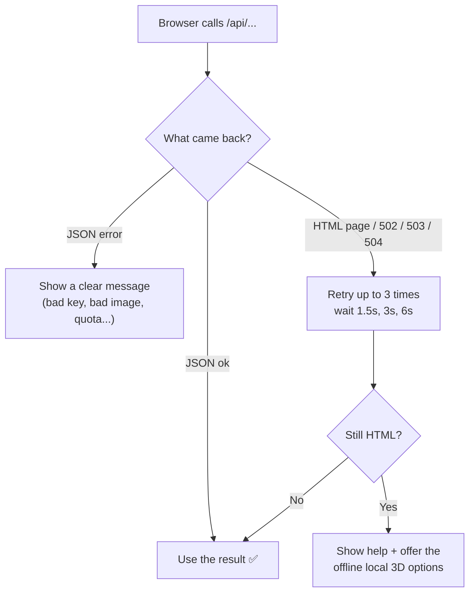

<div align="center">

# ✏️ Sketch2Shape — IntentLock 3D

### Turn a simple 2D sketch into a real 3D model you can download.

🌐 **Live site:** [https://sketch2shape.onrender.com/](https://sketch2shape.onrender.com/)
🎥 **Demo video:** [https://youtu.be/p_B2MfFig6Q](https://youtu.be/p_B2MfFig6Q)
💻 **Source code:** [github.com/swatipandey0001/Sketch2Shape](https://github.com/swatipandey0001/Sketch2Shape)
👥 **Team:** pandaysaurabh874 — Swati Pandey, Shivam Dwivedi

Draw or upload a sketch → AI understands it → you confirm the unclear parts → get a 3D model (`.GLB`, `.OBJ`, `.MTL`).


Built for **TechZephyr 4.0 — SKETCH2SHAPE AI**

</div>

---

## 📖 Table of Contents

1. [What is this project?](#-what-is-this-project)
2. [The problem](#-the-problem)
3. [Our solution](#-our-solution)
4. [How it works (flowchart)](#-how-it-works-flowchart)
5. [Architecture](#-architecture)
6. [Models and APIs used](#-models-and-apis-used)
7. [The three 3D options](#-the-three-3d-options)
8. [What objects can it build?](#-what-objects-can-it-build)
9. [Website pages](#-website-pages)
10. [Project structure](#-project-structure)
11. [Run it on your computer](#-run-it-on-your-computer)
12. [Deploy it online](#-deploy-it-online)
13. [Troubleshooting](#-troubleshooting)
14. [Limits (honest list)](#-limits-honest-list)

Also see: [Expected inputs and outputs](#-expected-inputs-and-outputs) · [Time, hardware and resources](#-time-required-hardware-and-resources) · [Reproducibility](#-reproducibility)

---

## 💡 What is this project?

**Sketch2Shape** is a website. You give it a flat drawing of an object, like a chair, a table, a mug, a lamp, a bookshelf or a metal bracket. It gives you back a 3D model that you can rotate on screen and download.

The special part is **IntentLock**. A 2D drawing hides many things (for example, the back legs of a chair). Instead of silently guessing, the app **asks you** about the important unclear parts and **locks your answers** before building the 3D model.

---

## 🧩 The problem

Making a 3D model by hand needs special software and a lot of time. Today's AI tools can make 3D from a picture, but they have problems:

| Problem | What goes wrong |
| :--- | :--- |
| A sketch only shows one side | The AI guesses the hidden parts and you do not know what it guessed |
| AI changes your drawing | The result may not look like what you drew |
| No control | You cannot say "this chair has no armrests" |
| Cloud-only tools | They need internet and a paid key, and fail if the server is down |
| No checking | A broken 3D file can be given to you without any warning |

---

## ✅ Our solution

| Our idea | How it helps |
| :--- | :--- |
| **Clean the sketch with normal computer vision** | We never let AI repaint your drawing. We only measure it (shape, size, symmetry, holes). |
| **Separate "seen" from "guessed"** | The app clearly shows what is **visible in your sketch** and what is **guessed by AI**. |
| **IntentLock** | The app asks you only about the **important** unclear parts and locks your choices. |
| **Three options** | You get 3 different 3D versions to compare, then you pick the one you like. |
| **Works without internet AI** | If Tripo or Gemini is not available, a built-in local builder still makes a 3D model. |
| **Check every file** | Every `.GLB` file is checked before you can download it. |

---

## 🔄 How it works (flowchart)



### The same flow in plain words

1. **Draw or upload.** Use the drawing canvas or upload an image (up to 20 MB).
2. **Clean up.** The browser fixes the background, boosts contrast, crops the drawing and finds the outline and any holes.
3. **Understand.** Gemini names the object and lists what it can see and what it is unsure about.
4. **Confirm.** IntentLock asks only the questions that really matter (0 to 4 questions).
5. **Build.** The app builds three 3D versions from your answers.
6. **Pick.** You rotate and compare them, then choose one.
7. **Check and download.** The file is validated, then you can download it.

---

## 🏗️ Architecture



### Why this design?

- **API keys never reach the browser.** Only the Express server reads `GEMINI_API_KEY` and `TRIPO_API_KEY`.
- **Most work happens in the browser.** Cleaning the sketch and building the local 3D takes milliseconds and needs no internet.
- **One server does two jobs.** In development, Express also runs Vite. In production, Express serves the built `dist/` folder.
- **The server never answers `/api/*` with a web page.** Any unknown API path returns JSON, so the app can tell real errors from proxy or warm-up pages.

### Error handling (so the app does not just break)



---

## 🧠 Models and APIs used

| Part | Tool | What it does |
| :--- | :--- | :--- |
| **Sketch understanding** | **Google Gemini** via `@google/genai`. Main model: `gemini-3.8-flash`. Backup model: `gemini-3.1-flash-lite`. | Looks at the sketch and returns a structured result: object name, visible parts, unclear parts, guessed parts, proportions and notes. If the main model is busy, it retries and then uses the backup. |
| **Cloud 3D (optional)** | **Tripo 3D OpenAPI v3**, model `v3.1-20260211` | Turns the sketch image into a textured 3D model on Tripo's servers. Steps: upload file, create task, poll until done. |
| **Local 3D (no key needed)** | **Three.js** shapes: `ExtrudeGeometry`, `LatheGeometry`, `TubeGeometry` | Builds chairs, tables, mugs, lamps, shelves and brackets from measured sketch data. |
| **Computer vision** | Our own code, no AI model | Alpha compositing, illumination flattening, contrast normalisation, contour tracing, symmetry score. |
| **3D viewing and export** | **Three.js** (`GLTFLoader`, `GLTFExporter`, `OrbitControls`) | Interactive viewer and file export. |

> The Gemini and Tripo keys are **server-side only**. Gemini keys that start with `AQ.` (the new format) and the older `AIza...` format both work with the official SDK.

---

## 🎛️ The three 3D options

After analysis, the app builds three different 3D models so you can choose.

| Option | Name | Idea |
| :--- | :--- | :--- |
| **A** | **Sketch Faithful** | Stays as close as possible to what you drew. Fewest guesses. |
| **B** | **Structurally Refined** | Adds the hidden parts that make it a believable object (aprons, stretchers, supports, joints). |
| **C** | **Design Enhanced** | Improves the look: smoother curves, bevels, metal fittings. Keeps the identity of your sketch. |

---

## 🪑 What objects can it build?

| Category | What is built |
| :--- | :--- |
| 🪑 **Chairs and seating** | Seat, backrest (solid, curved, slatted or open), optional armrests, legs (straight, splayed, tripod, pedestal), stretchers |
| 🛋️ **Tables and desks** | Beveled top, aprons, legs or pedestal, cross bars |
| ☕ **Mugs and vessels** | Hollow body turned on a lathe, foot ring, rim, 3D handle |
| 💡 **Lamps** | Base, stem, socket, support struts, hollow shade |
| 📚 **Bookshelves and cabinets** | Side panels, top and bottom, shelves placed where your lines were, back brace |
| 🔩 **Brackets and plates** | Exact outline with holes, raised bosses, base flange, ribs |
| 🐶 **Animals, faces, plants, vehicles** | Not supported by the local builder. The app says so honestly. Use the Tripo cloud option for these. |

---

## 🌐 Website pages

| Page | Purpose |
| :--- | :--- |
| **Dashboard** | Home screen of the app |
| **Studio** | The main workspace: draw, analyse, confirm, build, view, download |
| **History** | Your earlier results, saved in your own browser |
| **Diagnostics** | Test the server, keys and error handling |
| **Documentation** | Technical notes inside the app |

### Main features in the Studio

- Drawing canvas with brush, eraser, undo (25 steps), clear and PNG export
- Upload checks that read the real file type (a fake `.png` that is really HTML is rejected)
- Side-by-side view: **Original**, **Cleaned**, **Contour map**
- Hints box: object type, material, colour, style
- **Observed vs Guessed** map of the design
- Interactive 3D viewer: rotate, zoom, wireframe, clay view, material preview
- Downloads: `.GLB`, `.OBJ` and `.MTL`
- Original sketch fingerprint (SHA-256) to prove it was never changed

---

## 📁 Project structure

```text
Sketch2Shape/
├── server.ts                  # Express server: API routes, Gemini, Tripo
├── src/
│   ├── App.tsx                # Main app and Studio logic
│   ├── components/            # UI pieces (canvas, panels, 3D viewer, pages)
│   ├── types/studio.ts        # Shared TypeScript types
│   └── utils/
│       ├── apiClient.ts       # Safe JSON reading + automatic retry
│       ├── sketchPreprocessor.ts   # Computer vision cleanup
│       ├── intentCompiler.ts       # Turns your answers into build settings
│       ├── modularReconstructor.ts # Builds the 3 options
│       ├── sketchTo3DFallback.ts   # Limited raw contour extrusion
│       ├── glbValidator.ts         # Checks and exports 3D files
│       ├── historyStore.ts         # Saves history in the browser
│       └── builders/               # chair, table, vessel, lamp, shelf, bracket
├── scripts/run-tests.ts       # Automated tests
├── .env.example               # Example settings (copy to .env)
└── package.json
```

---

## 🚀 Run it on your computer

### You need

- **Node.js 20 or newer** → https://nodejs.org (LTS version)
- A **Gemini API key** → https://aistudio.google.com/apikey
- A **Tripo API key** (optional) → https://platform.tripo3d.ai

### Steps

**1. Install packages**

```bash
npm install
```

> If you see a peer-dependency error about `esbuild`, make sure `package.json` has `"esbuild": "^0.28.0"`, or run `npm install --legacy-peer-deps`.

**2. Create your `.env` file** (copy `.env.example` and fill it in)

```env
GEMINI_API_KEY="your_gemini_key"
TRIPO_API_KEY="tsk_your_tripo_key"
TRIPO_MODEL_VERSION="v3.1-20260211"
```

**3. Start the app**

```bash
npm run dev
```

**4. Open** http://localhost:3000

**5. Check that keys are loaded:** open http://localhost:3000/api/system/status

```json
{ "geminiConfigured": true, "tripoConfigured": true }
```

### Environment variables

| Variable | Needed? | Purpose |
| :--- | :--- | :--- |
| `GEMINI_API_KEY` | Yes, for AI analysis | Sketch understanding with Gemini |
| `TRIPO_API_KEY` | Optional | Cloud 3D with Tripo. Without it, the local builders are used. |
| `TRIPO_MODEL_VERSION` | Optional | Defaults to `v3.1-20260211` |
| `PORT` | Optional | Defaults to `3000` |

### Useful commands

| Command | What it does |
| :--- | :--- |
| `npm run dev` | Start the development server |
| `npm run build` | Build the website into `dist/` |
| `npm start` | Run the production server (build first) |
| `npm run lint` | Check TypeScript types |
| `npm test` | Run the automated tests (start `npm run dev` first for the upload tests) |

---

## ☁️ Deploy it online

This app needs a **Node.js server**, so use a host that runs Node (Render, Railway, Fly.io, Cloud Run). **Static-only hosts will not work**, because `/api/*` would have no server behind it.

### Example: Render

1. Push this repo to GitHub. Never commit `.env`. It is already in `.gitignore`.
2. On https://render.com choose **New → Web Service** and pick this repo.
3. Use these settings:

| Setting | Value |
| :--- | :--- |
| Runtime | Node |
| Build command | `npm install --include=dev && npm run build` |
| Start command | `npm start` |

4. Add environment variables: `GEMINI_API_KEY`, `TRIPO_API_KEY`, `TRIPO_MODEL_VERSION`, and `NODE_VERSION=22`.
5. Deploy, then open `/api/system/status` on your live URL to confirm both keys are loaded.

> Free servers go to sleep when unused. The first request can take up to a minute. The app retries automatically, so you do not need to click again.

> Anyone with your link can use your Gemini and Tripo credits. Set a budget or quota alert before sharing the link widely.

---

## 📥📤 Expected inputs and outputs

| | Details |
| :--- | :--- |
| **Input** | A 2D sketch: draw on the built-in canvas (768 × 576) **or** upload a PNG, JPG or WebP file (max 20 MB). Optional hints: object type, material, colour, style. |
| **Checks on input** | The file type is checked by its real bytes, so a fake `.png` that is really HTML, SVG or JSON is rejected. Empty files are rejected too. |
| **Output** | A 3D model as **`.GLB`**, plus **`.OBJ`** and **`.MTL`** (materials). The viewer shows it live, and the original sketch fingerprint (SHA-256) is shown beside it. |
| **Output checks** | Every GLB is validated before download: correct glTF 2.0 header, declared length, JSON chunk, finite vertex numbers, non-empty triangles, and a real 3D volume. |

### Example input and output files

Example files are in the [`samples/`](samples) folder:

| Input sketch | Generated 3D model |
| :--- | :--- |
| `wooden chair png.png` | `a_wooden_chair.glb` |
| `apple png.png` | `an_apple.glb` |
| `bedside-lamp-drawing.webp` | `table_lamp.glb` |
| *(drawn on the canvas)* | `a_coffee_mug.glb` |

Open any `.glb` file in an online viewer such as https://gltf-viewer.donmccurdy.com, or in Blender, to inspect it.

---

## ⏱️ Time required, hardware and resources

Most of the work runs in the browser and on hosted APIs, so **no GPU and no model weights are needed on your machine**.

| Stage | Where it runs | Typical time |
| :--- | :--- | :--- |
| Sketch cleanup and contour tracing | Your browser (CPU) | about 8 to 45 ms |
| Gemini sketch analysis | Google Gemini API | about 1.5 to 5 seconds |
| Local 3D build and GLB check (3 options or contour fallback) | Your browser (CPU) | about 15 to 90 ms per model |
| Tripo cloud 3D (optional) | Tripo servers | about 25 to 90 seconds (we stop waiting after 180 seconds) |

> These are typical values from the app's own stage timers. Times change with the image, the network and API load. Your own timings are saved in the **History** page for each run.

**Hardware used**

- **Development machine:** a normal Windows laptop or desktop with Node.js. No discrete GPU or CUDA.
- **Browser:** any WebGL-capable browser. The viewer lowers shadow quality by itself on software rendering.
- **Hosting:** a small Render web service (free tier, shared CPU and limited memory). The first request after sleep can take up to a minute.
- **Compute used for AI:** Google Gemini and Tripo run on their own servers. We only send them the sketch image.

---

## 🔁 Reproducibility

| Item | Details |
| :--- | :--- |
| **Runtime** | Node.js 20 or newer, npm |
| **Main dependencies** | React 19, Express 4, Three.js, `@google/genai`, Multer, Tailwind CSS 4, Vite, TypeScript (all listed in `package.json`) |
| **Install** | `npm install` (if npm reports an `esbuild` peer conflict, keep `"esbuild": "^0.28.0"` in `package.json`) |
| **Model weights** | **None to download.** All AI models are used through hosted APIs. |
| **External services** | Google Gemini API (needed for AI analysis) and Tripo 3D API (optional) |
| **Configuration** | `.env` file with `GEMINI_API_KEY`, optional `TRIPO_API_KEY` and `TRIPO_MODEL_VERSION` (see `.env.example`) |
| **Run** | `npm run dev` then open http://localhost:3000 |
| **Without any keys** | The local builders and the raw contour fallback still produce a GLB, so a run can be reproduced without paid services. |
| **Tests** | `npm test` runs the automated checks (start `npm run dev` first for the upload tests) |

**Why these models?**

- **Gemini** reads a sketch and returns structured data (object name, visible parts, unclear parts), which IntentLock needs. A smaller backup model is used if the main one is busy.
- **Tripo** is a cloud image-to-3D model, useful for organic shapes that our local builders cannot make.
- **Three.js local builders** make clean, checkable CAD-style models with no key, no cost and no waiting.

---

## 🛠️ Troubleshooting

| Message | What to do |
| :--- | :--- |
| **Server Returned HTML Instead of JSON** | The Node server is not running, or a host or proxy is serving only static files. Open `/api/health`. You should see JSON. Run with `npm run dev`. |
| **Gemini API Key Not Configured** | `.env` is missing or not loaded. Check the file name is exactly `.env`, it is next to `server.ts`, and you restarted the server. |
| **API key not valid** | The key value is wrong or still the placeholder text. Copy the key again from AI Studio. |
| **`npm` is not recognized (Windows)** | Install Node.js, then open a new PowerShell window. |
| **Scripts are disabled (PowerShell)** | Run `Set-ExecutionPolicy -Scope CurrentUser RemoteSigned` or use `npm.cmd`. |
| **429 / quota** | You hit the free Gemini limit. Wait a minute and try again. |
| **Port already in use** | Run `npm run dev -- --port 3001`. |

If Gemini is not working, you can still use **Compare 3 Modular 3D Options (Local CV + Hints)** or **Limited Raw Contour Extrusion**. Both work offline.

---

## ⚠️ Limits (honest list)

- One sketch shows only one view, so hidden sides are **estimates**. IntentLock helps, but it cannot see what is not drawn.
- The local builder makes clean CAD-style models. It **cannot** invent organic detail such as faces or cloth folds. Tripo is better for that.
- Thin, broken or very faint lines can merge during cleanup. Bold, closed outlines work best. For photos of paper, turn on **Flatten uneven paper lighting**.
- Tripo builds from image pixels. Your material and colour choices are shown as a preview in the viewer and saved in the `.MTL` file. They are not sent to Tripo as text.
- Tripo can take 25 to 90 seconds, with a 180-second timeout.

### Problems you may meet when generating a model

| Problem | Why it happens | What to do |
| :--- | :--- | :--- |
| Slow first request | Free hosting sleeps when unused | Wait up to a minute. The app retries by itself. |
| "Server returned HTML instead of JSON" | A proxy or warm-up page answered, not the API | Wait and retry, or use the local options |
| Gemini quota or key errors | Free limits, or a wrong key | Wait a minute, or create a new key |
| Animals, faces, plants, vehicles | The local builder does not support organic shapes | Use the Tripo cloud option |
| Model looks thin or merged | Faint or broken sketch lines | Use bold, closed outlines and turn on paper-light flattening |
| Tripo task fails or times out | Queue load or credits | Retry, or use the local 3 options |

---

<div align="center">

**Sketch2Shape — IntentLock 3D**
*Draw it. Confirm it. Download it in 3D.*

</div>